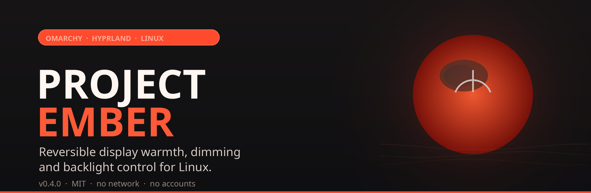
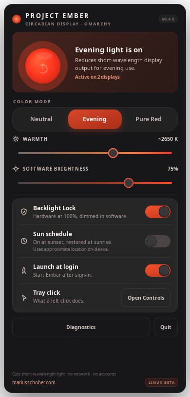
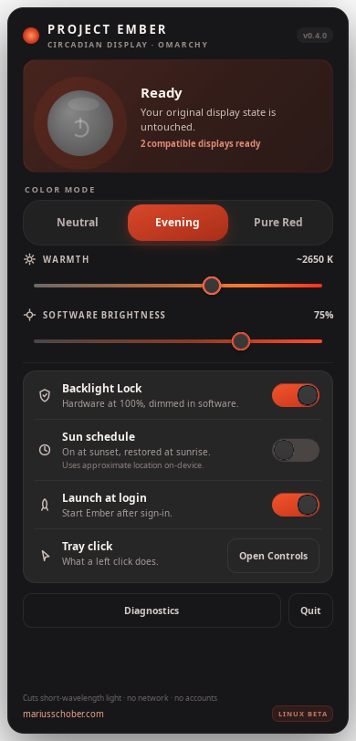
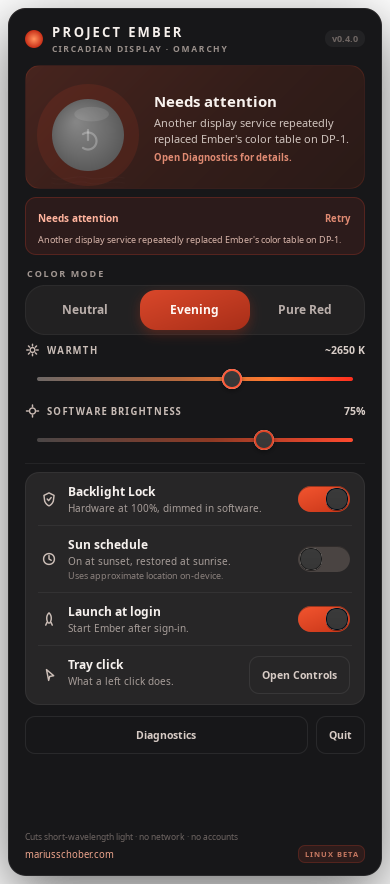
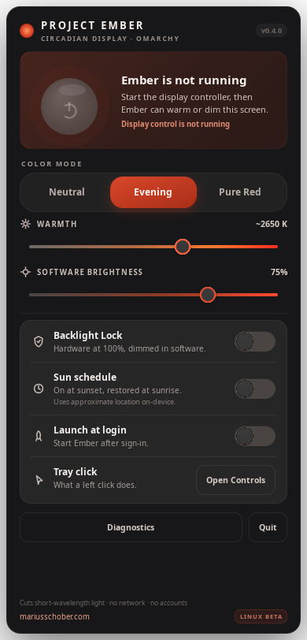
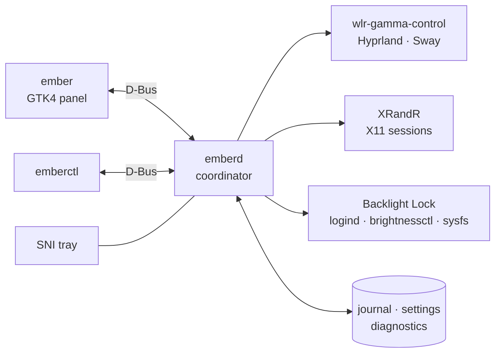

<p align="center">
  
</p>

<p align="center">
  <a href="https://github.com/mariusschober/ProjectEmberLinux/releases/latest"></a>
  <a href="LICENSE"></a>
  <a href="https://github.com/mariusschober/ProjectEmberLinux/actions/workflows/ci.yml"></a>
  
  
  
</p>

<h3 align="center">Warm, dim and protect your display after sunset — reversibly.</h3>

<p align="center">
  A native Linux port of <a href="https://github.com/mariusschober/project-ember">Project Ember for macOS</a>,
  built for <b>Omarchy</b>, Hyprland, Sway, wlroots and X11.
</p>

<p align="center">
  
</p>

<p align="center">
  <sub>Native GTK4 panel, rendered by the app itself under Xvfb during the test suite.</sub>
</p>

> [!NOTE]
> **The honest bit about Wayland.** Wayland has no gamma readback. On Hyprland and
> Sway, Ember reports **“accepted by compositor”**; on X11 it reports **“verified by
> readback”**. It never claims more than it can prove. See [`docs/LIMITATIONS.md`](docs/LIMITATIONS.md).

## Why Project Ember

- **Reversible by design.** Each display’s original state is journaled before the
  first write, and restores are verified before the journal is cleared.
- **Per-display memory.** Unplug a monitor and it becomes *pending*; plug the
  same physical display back in and its own baseline returns. Other displays are
  never blanked or restored by accident.
- **Built-in Backlight Lock.** Keep the laptop panel’s hardware backlight at
  100 % while Ember dims in software — restored on off, quit, sleep and next boot.
- **A real Sun schedule.** Sunrise/sunset calculated locally with NOAA math,
  DST-aware and polar-aware, with manual overrides until the next boundary.
- **Native on Omarchy.** StatusNotifierItem tray, anchored layer-shell panel,
  systemd user unit, D-Bus activation, XDG autostart and an optional Omarchy menu
  extension. No Electron, no web view, no daemon-as-root.
- **No cloud.** No network requests, accounts, telemetry, analytics or tracking.
  Diagnostics stay local and use salted display identifiers.

## Install

### Omarchy / Arch — two-minute install

```bash
sudo pacman -S --needed base-devel rust cargo gtk4 wayland libxkbcommon dbus
git clone https://github.com/mariusschober/ProjectEmberLinux.git
cd ProjectEmberLinux
./scripts/install.sh --user --omarchy
ember
```

`--user` installs into `~/.local` and adds an XDG autostart entry — no root
required. Use `sudo ./scripts/install.sh --omarchy` for a system-wide install.
Restart your session, or launch `ember` immediately; the tray icon appears in
the Omarchy bar.

### Arch package

```bash
git clone https://github.com/mariusschober/ProjectEmberLinux.git
cd ProjectEmberLinux/packaging
makepkg -si
systemctl --user enable --now project-ember.service
```

The PKGBUILD builds the `v0.4.0` tag from this repository and installs
`/usr/bin/{emberd,emberctl,ember}`, the desktop entry, icons, systemd user unit
and D-Bus activation file. `makepkg -s` installs the build dependencies.

### Any other Linux

```bash
./scripts/install.sh --user
```

Requires GTK4, Wayland client libraries, `libxkbcommon` and a session D-Bus.
Hyprland or Sway must expose `wlr-gamma-control` for Wayland color control;
plain X11 uses XRandR. GNOME/KDE without that protocol are reported as
unsupported rather than silently ignored.

### Verify

```bash
emberctl probe --json     # read-only hardware/session probe
emberctl status           # daemon state, backend and verification level
ember --version           # 0.4.0 (build 5, Omarchy) · GTK 4.x
```

### Uninstall

```bash
./scripts/uninstall.sh --user      # keep settings and recovery data
./scripts/uninstall.sh --user --purge
# or: pacman -R project-ember
```

## First run

| Action | What happens |
|---|---|
| Click the tray icon | Opens the panel (configurable to toggle instead) |
| Click the big orb | Turns Ember on/off; the orb is the only on/off control |
| Neutral / Evening / Pure Red | One-click presets; Pure Red drives only the red channel |
| Warmth / Software brightness | Per-display, derived from the immutable baseline |
| Backlight Lock | Built-in panel only; hardware at 100 %, software dimming on top |
| Sun schedule | On at sunset, restored at sunrise; local calculation |
| Launch at login | Writes an absolute-path XDG autostart entry |
| Quit | Restores every display and stops the daemon |

Right-click the tray for the full menu. `Esc` closes the panel.

## Screenshots

<table>
  <tr>
    <td align="center"><br><sub><b>Active</b> — verification and next solar event</sub></td>
    <td align="center"><br><sub><b>Off</b> — original state untouched</sub></td>
  </tr>
  <tr>
    <td align="center"><br><sub><b>Needs attention</b> — recovery stays visible</sub></td>
    <td align="center"><br><sub><b>Offline</b> — no stale “active” claim</sub></td>
  </tr>
</table>

## How it works



- **`emberd` is the only writer.** The GUI and CLI never touch display state
  directly; they send validated commands over the user session bus.
- **One backend interface.** Wayland (`zwlr_gamma_control_v1`), X11 (XRandR),
  a deterministic simulator and a truthful null backend share the same trait.
- **A pure core.** Color science, topology, reconciliation, presentation,
  journal and solar math are platform-free and heavily unit-tested.
- **Generations, not guesses.** Hot-plug reconciliation checks a topology
  generation before every delayed write; stale work is discarded.
- **The UI mirrors observed truth.** It is a pure function of the daemon
  snapshot, so a failed display is never painted as active.

Read [`docs/SYSTEM_DESIGN.md`](docs/SYSTEM_DESIGN.md) for the full architecture
and [`docs/PORTING.md`](docs/PORTING.md) for the macOS → Linux mapping.

## Safety model

1. **Journal before mutation.** Baselines and intended settings are durably
   written before any gamma or backlight write.
2. **Verified restore before deletion.** An entry is removed only after the
   backend confirms restoration.
3. **Immutable baselines.** Moving sliders never compounds transforms.
4. **No blanket restore.** Unplugging one display cannot restore the survivor.
5. **Disconnected is pending.** It is remembered, not forgotten.
6. **Ambiguity means no mutation.** Duplicate or unknown identities are left
   untouched and explained.
7. **Built-in Backlight Lock only.** External DDC/CI is deliberately out of
   scope; there is no root, KMS or `/dev/dri` access.
8. **No silent fallback.** A Wayland session never quietly falls back to
   XWayland for color, because that would only tint X11 clients.
9. **Corrupt journals are quarantined**, never treated as empty or deleted.
10. **Offline is visible.** If the daemon stops, the panel says so instead of
    showing stale “active” state.

If a display ever looks wrong:

```bash
emberctl restore     # restore saved state for every available display
emberctl reset       # restore and clear preferences
emberctl quit        # restore and stop the daemon
```

The full decision tree is in [`docs/SAFETY.md`](docs/SAFETY.md).

## Command line

`emberctl` is the same API the panel uses — ideal for Omarchy keybindings,
scripts and troubleshooting.

| Command | Description |
|---|---|
| `emberctl status [--json]` | Human-readable or complete JSON snapshot |
| `emberctl on` / `off` / `toggle` | Enable, restore, or flip the filter |
| `emberctl warmth 62` | Warmth, 0–100 % (100 is red-only) |
| `emberctl brightness 75` | Software brightness, 10–100 % |
| `emberctl preset evening` | `neutral`, `evening` or `pureRed` |
| `emberctl backlight on` | Built-in Backlight Lock |
| `emberctl schedule on` | Sun schedule; also enables launch at login |
| `emberctl location set 52.5 13.4` | Manual approximate coordinates |
| `emberctl retry` / `reset` / `restore` | Recovery controls |
| `emberctl diagnostics --export ~/ember.txt` | Local diagnostics export |
| `emberctl probe --json` | Read-only backend/display probe |
| `emberctl simulate all` | Seven deterministic scenarios, no hardware |
| `emberctl quit` | Restore displays and stop the daemon |

## Omarchy integration

- **Tray:** native SNI icon in the Quickshell bar, with a rendered ember glyph.
- **Panel:** `gtk4-layer-shell` overlay anchored under the bar; falls back to a
  normal window when the library or compositor support is absent.
- **Menu:** `./scripts/install.sh --omarchy` adds the Ember rows to
  `~/.config/omarchy/extensions/omarchy-menu.jsonc` **only if that file does not
  exist**. If it already exists, your file is left untouched and the snippet is
  placed in the docs directory for a manual merge.
- **Keybindings:** add to `~/.config/hypr/bindings.lua`:

  ```lua
  o.bind("SUPER + SHIFT + E", "Ember controls", "ember")
  o.bind("SUPER + SHIFT + T", "Toggle Ember", "emberctl toggle")
  o.bind("SUPER + SHIFT + N", "Ember night preset", "emberctl preset evening")
  ```

- **Nightlight:** Omarchy’s `hyprsunset` uses Hyprland’s CTM protocol, a
  different stage from Ember’s gamma LUT. They can coexist, but the tints
  compound. Ember detects and reports this and offers a manual
  **Turn Off Nightlight** action; it never disables another service on its own.

Hardware checklist and Omarchy notes: [`docs/OMARCHY.md`](docs/OMARCHY.md).

## Files and state

| Path | Contents |
|---|---|
| `~/.config/project-ember/settings.json` | Warmth, brightness, presets, preferences |
| `~/.local/state/project-ember/display-recovery-v1.json` | Per-display recovery journal (0600) |
| `~/.local/state/project-ember/diagnostics.log` | Rotating local diagnostics |
| `~/.config/autostart/project-ember.desktop` | Launch at login |
| `$XDG_RUNTIME_DIR/project-ember/daemon.lock` | Single-instance lock |

XDG variables are respected. The daemon never runs as root and never writes
outside these user directories (plus the autostart entry).

## Compatibility

| Session | Backend | Verification |
|---|---|---|
| Omarchy / Hyprland (Wayland) | `zwlr_gamma_control_v1` | Accepted by compositor |
| Sway / other wlroots | `zwlr_gamma_control_v1` | Accepted by compositor |
| X11 (Intel, AMD, Xvfb) | XRandR | Verified by readback |
| Wayland without wlr gamma protocol | Unsupported | Truthfully reported, no writes |
| XWayland under Hyprland | Not used | No silent downgrade |
| Headless / no session | Null backend | Daemon and UI still truthful |

Supported architectures: **x86_64** and **aarch64**. Built and checked on both
targets; the release CI builds x86_64.

## Testing

```bash
./scripts/run-tests.sh        # unit, protocol, D-Bus, simulation, GUI, release
./scripts/red-team.sh         # adversarial suite
./scripts/e2e-simulated.sh    # real daemon + CLI + GUI on a private bus
```

| Suite | Result |
|---|---|
| Pure core unit tests | 115 passed |
| Platform unit tests | 39 passed |
| Mock Wayland compositor | Exact u16 ramp bytes, `failed`, restore-on-destroy |
| X11 XRandR | Real readback and idempotent restore (Xvfb) |
| D-Bus integration | Private `dbus-daemon`, invalid inputs rejected |
| Simulator | 7/7 scenarios |
| Red team | 7/7 adversarial tests |
| GUI | Active/off/degraded/offline screenshots rendered from the app |

The strongest available proof without physical hardware is the in-process mock
compositor: it validates the exact interleaved `uint16` ramp written through
`zwlr_gamma_control_v1`, not just internal state. See
[`docs/TEST_PLAN.md`](docs/TEST_PLAN.md) and
[`docs/RED_TEAM_REPORT.md`](docs/RED_TEAM_REPORT.md).

> [!WARNING]
> Real Omarchy hardware acceptance is still pending. The mock protocol test,
> Xvfb, private D-Bus, simulator and red-team suite are complete; actual
> Hyprland gamma behavior, the Intel Mac backlight device, suspend/resume and
> Quickshell tray placement are the remaining hardware gate. Use
> [`docs/OMARCHY.md`](docs/OMARCHY.md) on the test machine.

## Documentation

| Document | What it covers |
|---|---|
| [`docs/SYSTEM_DESIGN.md`](docs/SYSTEM_DESIGN.md) | Architecture, invariants, backends, IPC |
| [`docs/PORTING.md`](docs/PORTING.md) | macOS → Linux review and feature mapping |
| [`docs/SAFETY.md`](docs/SAFETY.md) | Recovery model and failure decision tree |
| [`docs/OMARCHY.md`](docs/OMARCHY.md) | Omarchy setup and hardware acceptance checklist |
| [`docs/TEST_PLAN.md`](docs/TEST_PLAN.md) | Test matrix and evidence |
| [`docs/RED_TEAM_REPORT.md`](docs/RED_TEAM_REPORT.md) | Adversarial results and residual risk |
| [`docs/LIMITATIONS.md`](docs/LIMITATIONS.md) | Honest platform boundaries |
| [`CHANGELOG.md`](CHANGELOG.md) | Release history |
| [`SECURITY.md`](SECURITY.md) | Threat model and reporting |

## Status

| | |
|---|---|
| Version | **0.4.0** (build 5, Omarchy edition) |
| License | **MIT** |
| Platforms | Omarchy, Arch Linux, Sway/wlroots, X11 |
| Hardware acceptance | **Pending** — checklist in `docs/OMARCHY.md` |
| Network | None. No accounts, telemetry or tracking. |

## Contributing

Bug reports, hardware reports and pull requests are welcome. Before changing
display or recovery code, read [`docs/SAFETY.md`](docs/SAFETY.md); the
journal-before-mutation and verified-restore invariants are non-negotiable.
Run `./scripts/run-tests.sh` and `./scripts/red-team.sh` before opening a PR.
Security issues: see [`SECURITY.md`](SECURITY.md).

## License

MIT © 2026 [Marius Schober](https://mariusschober.com/). See [`LICENSE`](LICENSE).

<p align="center">
  <sub>Based on the macOS <a href="https://github.com/mariusschober/project-ember">Project Ember</a> · Built for <a href="https://omarchy.org/">Omarchy</a> · No cloud, no accounts, no compromise.</sub>
</p>
